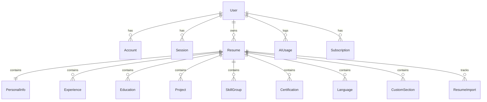

# Database Design Specification

## 1. Overview
The database uses PostgreSQL with Prisma ORM. It provides strict foreign keys, cascade deletes, relational indexing on `userId`, `resumeId`, and composite unique keys where necessary.

---

## 2. Entity Relationship Model

---

## 3. Core Models & Columns

### 3.1 User & Auth
- **User**: `id`, `name`, `email` (unique), `passwordHash`, `role` (USER | ADMIN), `plan` (FREE | PRO), `image`, `createdAt`, `updatedAt`
- **Account**: NextAuth OAuth provider linkage (`provider`, `providerAccountId`, `userId`)
- **Session**: Active user sessions (`sessionToken`, `userId`, `expires`)

### 3.2 Resume & Configuration
- **Resume**:
  - `id` (cuid/uuid)
  - `userId` (FK -> User.id, cascade delete)
  - `title` (e.g., "Senior Full-Stack Engineer Resume")
  - `slug` (unique per user)
  - `templateId` (default: "modern", "classic", "minimal")
  - `themeColor` (hex code, default: "#2563eb")
  - `fontFamily` (default: "Inter", "Merriweather", "Roboto")
  - `fontSize` ("sm" | "base" | "lg")
  - `pageMargin` ("compact" | "normal" | "spacious")
  - `sectionOrder` (JSON array of section IDs for drag-and-drop order)
  - `version` (int for optimistic locking)
  - `isPublished` (boolean)
  - `createdAt`, `updatedAt`

### 3.3 Relational Resume Data
- **PersonalInfo**: `id`, `resumeId` (unique), `fullName`, `headline`, `email`, `phone`, `location`, `website`, `linkedin`, `github`, `summary`
- **Experience**: `id`, `resumeId`, `company`, `position`, `location`, `startDate`, `endDate`, `isCurrent`, `description` (bullets/markdown), `order`
- **Education**: `id`, `resumeId`, `institution`, `degree`, `fieldOfStudy`, `startDate`, `endDate`, `score`, `location`, `order`
- **Project**: `id`, `resumeId`, `title`, `subtitle`, `url`, `githubUrl`, `startDate`, `endDate`, `description`, `technologies` (String[]), `order`
- **SkillGroup**: `id`, `resumeId`, `category` (e.g. "Languages", "Frameworks"), `skills` (String[]), `order`
- **Certification**: `id`, `resumeId`, `name`, `issuer`, `issueDate`, `expiryDate`, `url`, `order`
- **Language**: `id`, `resumeId`, `name`, `proficiency` (e.g. "Native", "Fluent"), `order`
- **CustomSection**: `id`, `resumeId`, `title`, `content`, `order`

### 3.4 AI Usage & Import Tracking
- **ResumeImport**: `id`, `userId`, `fileName`, `fileType`, `extractedTextRaw`, `status` (PENDING | PARSED | FAILED), `error`
- **AIUsage**: `id`, `userId`, `operation` (PARSE | BULLET_IMPROVE | SUMMARY_GEN | GAP_ANALYSIS), `tokensUsed`, `createdAt`
- **Subscription**: `id`, `userId`, `status` (ACTIVE | CANCELLED | PAST_DUE), `plan` (FREE | PRO), `currentPeriodEnd`
